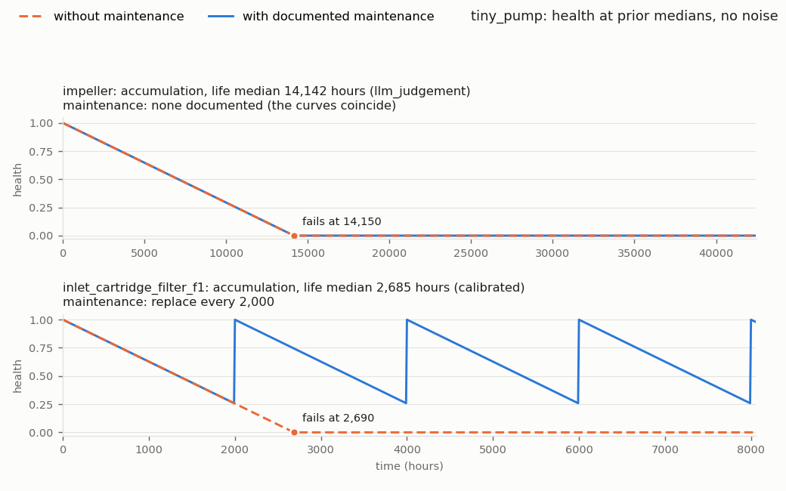
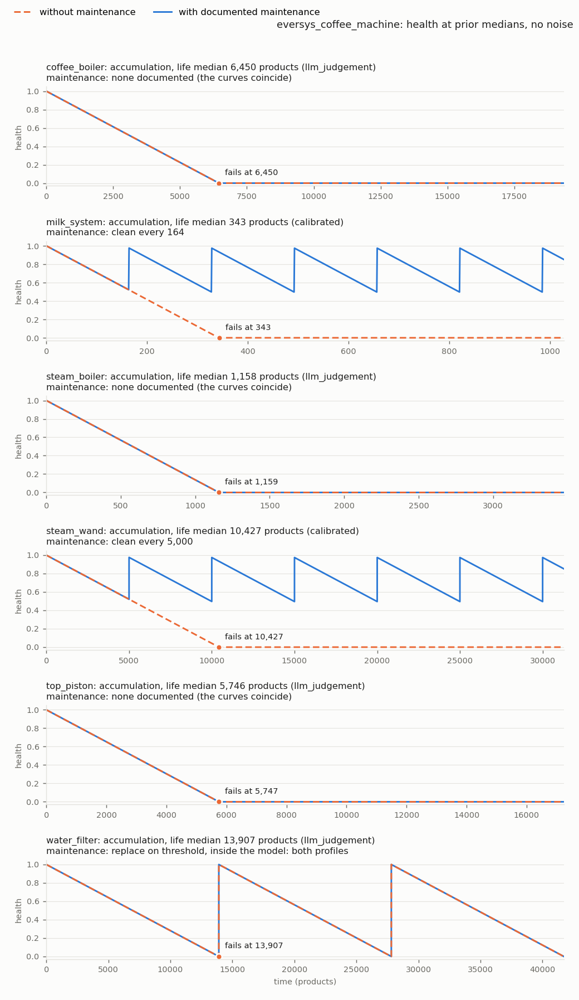
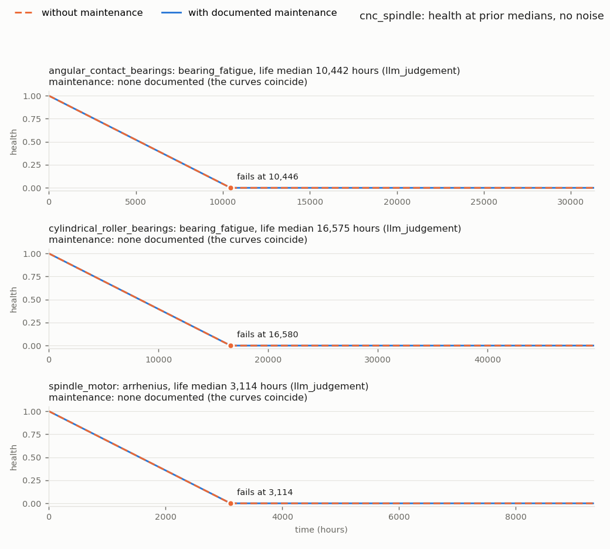

# Kaful walkthrough: M0–M10

This is a guided tour of what has been built, written for someone who has not read the code.
- **Part 1** goes milestone by milestone: the problem, what was built, the key files, a command to see it
  working, your decisions, and the open gaps.
- **Part 2** follows one real machine (eversys) from its PDF to a simulated twin, phase by phase, with each
  phase's output file.
- **Part 3** is the demo: tiny_pump end to end, and eversys and CNC simulated with and without maintenance.
- **Part 4** is a glossary.
- **Part 5** lists what is not built yet.

Paths use the current layout (`kaful/phases/p1_ingest/…`). Each milestone's full record is in
`docs/milestones/M<n>.md` (M6 onwards); PLAN.md holds the ticked boxes and the logged gaps.

---

## Part 1. Milestones

### M0. Freeze the baseline
- **Problem.** Before changing anything we needed a fixed point to compare against and to roll back to.
- **Built.**
  - The tag `pre-revamp`.
  - Pinned dependencies.
  - pytest set-up with markers (`slow`, `evals`, `live`).
  - A tarball of the legacy outputs, kept outside the repo.
- **Files.**
  - `requirements.txt`: exact versions of everything the code imports.
  - `pyproject.toml`: the package definition and pytest settings (plain `pytest` never makes live calls).
  - `.env.example`: which API keys `.env` must hold, without their values.
- **See it.** `git show pre-revamp --stat`, then `pytest -q`.
- **Your decisions.**
  - The uncommitted eversys changes were committed before tagging.
  - The repo moved out of iCloud to `~/code/Kaful`.
- **Open gaps.** None.

### M1. Measure the legacy pipeline's cost
- **Problem.** Nobody knew what a run cost, or where the money went.
- **Built.**
  - A minimal ledger wrapped around every legacy LLM, PDF-extraction and embedding call.
  - A pricing table.
  - A cost table per phase and per step.
- **Files.**
  - `utils/ledger.py`: the legacy ledger (one JSON line per call).
  - `pricing.toml`: prices per model; costs are computed from it, never typed in.
  - `docs/m1_cost_baseline.md`: the baseline. eversys costs $5.96 from scratch; CNC $22.06. The three biggest
    costs are phase 1 re-extraction, phase 6b code generation and CNC step 2c.
- **See it.** Open `docs/m1_cost_baseline.md`.
- **Your decisions.** Estimate from existing data instead of paying for fresh legacy runs ($0 spent).
- **Open gaps.** The CNC baseline is partly estimated ($14.46–17.61 for phase 1).

### M2. Offline harness and golden run
- **Problem.** Tests must never call an API. We also needed a way to notice when a change alters results.
- **Built.**
  - A network block for tests.
  - Fake LLM and embedding clients that replay recorded answers by prompt hash.
  - The tiny fixture machine `tiny_pump`.
  - A golden snapshot of eversys's late-phase outputs.
- **Files.**
  - `tests/harness/netblock.py`: makes any network access in a test fail.
  - `tests/harness/fake_anthropic.py` and `tests/harness/fake_embedder.py`: replay recorded responses.
  - `tests/fixtures/machines/tiny_pump/`: a 3-page synthetic manual with 7 sensor channels.
  - `tests/integration/test_golden_eversys.py`: the `slow` regression against the snapshot (about 9 minutes).
- **See it.** `pytest -q tests/integration/test_tiny_pump_replay.py` (about 1 s), or `pytest -m slow`.
- **Your decisions.** Close M2 early and freeze the legacy code rather than fix it.
- **Open gaps.**
  - The full end-to-end tiny-machine run was not met on the *legacy* pipeline. The new pipeline now runs
    tiny_pump from PDF to twin offline (Part 3).
  - Legacy phase 3 can't replay because of the hash-order bug (3a). The new understand phase was built to
    avoid it (rule 14, tested under two hash seeds).

### M3. Remove dead code
- **Problem.** `data_pipeline/` belonged to another project.
- **Built.** It was deleted, after `reconcile.py` was saved outside the repo.
- **Files.** `kaful/reference/`: where M4 brought `reconcile.py` back as a reference.
- **See it.** `ls data_pipeline` (it is gone).
- **Your decisions.** The rest of the legacy code stays frozen until M15.
- **Open gaps.** None.

### M4. Package skeleton and typed artifacts
- **Problem.** Legacy phases passed loose JSON to each other, and runs overwrote each other.
- **Built.**
  - The `kaful/` package and the `kaful run` command.
  - Typed models for every artifact.
  - A run manifest, with one folder per run.
  - A sandbox for generated code.
  - The interfaces for later milestones: `TwinBackend`, `DataSource`, templates.
- **Files.**
  - `kaful/artifacts/`: one Pydantic model per artifact (DocumentIndex, MachineModel, ParamSet, and so on),
    each with a schema version.
  - `kaful/pipeline.py`: starts a run, runs the selected phases in order, writes the manifest.
  - `kaful/runs.py`: run ids, run folders, saving and loading artifacts (each load checks the sha256 the
    manifest recorded).
  - `kaful/sandbox/runner.py`: runs generated code in a separate process with a time limit.
  - `kaful/backends/base.py`: the `TwinBackend` interface. ProgPy became its first adapter in M10.
- **See it.** `pytest -q tests/unit/test_kaful_artifacts.py`, then open any
  `outputs/runs/<run_id>/manifest.json`.
- **Your decisions.** Health is tracked as physical damage D, with health = 1 − D/D_limit.
- **Open gaps.** None left (hypothesis was installed in M9).

### M5. LLM gateway, prompt registry, evals
- **Problem.** LLM calls were scattered across the legacy code, with no cost control, no caching and no way to
  tell whether a prompt was good.
- **Built.**
  - **One gateway** that every model call goes through. It handles the ledger, the response cache, the budget
    stop, batches, and one retry when output fails validation.
  - **A prompt registry,** with each prompt versioned and locked.
  - **An eval framework,** with checks, golden cases and an optional LLM judge.
- **Files.**
  - `kaful/llm/gateway.py`: the only door to a model.
  - `kaful/llm/ledger.py` and `kaful/llm/cache.py`: the record of every call, and the stored answers.
  - `kaful/prompts/registry.py` and `kaful/prompts/versions.lock.json`: prompt files, and which versions are
    approved.
  - `kaful/evals/runner.py`: runs a prompt's eval set and scores it against thresholds.
- **See it.**
  - `kaful eval run sample.list_sensor_channels` replays offline at $0.
  - `kaful prompts check`.
- **Your decisions.**
  - Model choice is per prompt, in config.
  - The cheapest model that passes wins, so the sample prompt and the judge run on Haiku.
- **Open gaps.** None (unit parsing came in M7).

### M6. Ingest
- **Problem.** Legacy sent every page to an LLM ($2.18 for eversys, about $15.85 for CNC). Its quotes came
  from that transcription, not from the manual.
- **Built.** PDFs become a `DocumentIndex`:
  - raw text and printed labels for every page;
  - a class for every page;
  - free tables where PyMuPDF can read them;
  - Haiku on hard pages, with Sonnet re-reading pages that have tables or failed;
  - deterministic chunks;
  - embeddings that never cut text.
- **Cost.** eversys **$0.21**, CNC **$3.71**.
- **Files.**
  - `kaful/phases/p1_ingest/phase.py`: runs the steps a→g, and opens with a map of them.
  - `c_classify_pages.py`: decides which pages need the LLM.
  - `e_extract_hard_pages.py`: Haiku first; escalation to Sonnet.
  - `f_chunk_pages.py`: chunks and the coverage check.
  - `kaful/llm/embeddings.py` and `kaful/llm/tokens.py`: exact token counts and windows.
- **See it.** `kaful run eversys_coffee_machine --only ingest --budget 0.65` costs $0 now, because every
  answer is cached.
- **Your decisions.** Recorded in `docs/milestones/M6.md`: the gate, the routing, chunker v2, the matcher
  rules, two-run locks, reuse of v2 answers.
- **Open gaps.**
  - A batch-poll network error crashes the run.
  - The cheaper escalation is parked.

### M7. Understand (+ sensor contract)
- **Problem.** Legacy turned a manual into a flat "field schema". Its values had no checked evidence, sensors
  and alarm limits counted as fields, and examples on screenshots became specs.
- **Built.** The understand phase reads the index and writes three artifacts:
  - `MachineModel`: the component tree, flow paths and fault modes;
  - `SensorContract`: the channels the machine reports, with units (pint), ranges, sampling and a role
    (observation, operating input, event, usage clock);
  - `UnderstandReport`: what was checked, merged, dropped and downgraded.

  How:
  - three locked Haiku prompts (`understand.components`, `.sensor_channels`, `.fault_modes`), each sampled 3
    times; agreement across samples becomes confidence;
  - a merge that makes near-duplicates one item, on evidence the run produced;
  - every quote checked by code against the cited page's raw text (`verbatim`, `near`, `in_layer`,
    `unsupported`); an item with no accepted quote is downgraded to `llm_judgement`;
  - **value roles**: every value is `spec`, `variant`, `default`, `setting_range` or `example`; code may
    downgrade a role, never upgrade an example;
  - machine.toml `[[components]]`, `[[instrumentation]]` and `[instances]` for what the deployment adds;
  - golden labels and `kaful understand score`; the onboarding review page and `review-apply`.
- **Files.**
  - `kaful/phases/p2_understand/phase.py` and its steps `a_select_context`, `b_merge_samples`,
    `c_verify_quotes`, `d_build_artifacts`; `helpers/canonical_names.py` (the merge rules).
  - `kaful/evidence.py`: the quote matcher (shared).
  - `kaful/units.py`, `kaful/value_roles.py`.
  - `kaful/prompts/understand/*/`: prompts, output models, eval sets.
  - `tests/fixtures/understand/golden/*.toml`: the labels.
- **See it.**
  - `kaful run eversys_coffee_machine --only understand --base-run 20261105T211444Z-ae182c` (cache, $0).
  - `kaful understand score eversys_coffee_machine --run 20261109T161153Z-8fb3a8`.
  - `kaful understand review eversys_coffee_machine --run 20261109T161153Z-8fb3a8`, then open the HTML page
    under `machines/eversys_coffee_machine/outputs/understand_reviews/`.
- **Your decisions.** Explicit sampling (no guessed rates); `[[instrumentation]]` with source `deployment`;
  `Component.parent`; the `literature` source; pint; value roles; screenshot values are examples; whole
  documents when they fit; sudden jams are not fault modes; `documented = false` golden rows; declared items
  never count toward recall; prompt changes are general rules only; air_compressor as a blind hold-out; exit
  floors with a time-box; sensor_channels v6 dropped (v5 stays locked).
- **Open gaps.** CNC missed its floors (channel precision and roles, fault modes, component precision);
  parent accuracy has no floor; budget reservations reserve 7–8× actual for extract_page.

### M7b. Understand follow-ups
- **Problem.** On the air_compressor hold-out, fault-mode recall was 0.31: parts named only in maintenance
  schedules were never components, so their fault modes had nowhere to attach. Status signals came out as
  observations.
- **Built.**
  - `understand.fault_modes` v4 proposes **carriers** (a part that wears that the components step missed).
    A carrier needs a quote from a machine document; a datasheet-only part is dropped and listed in the
    onboarding review for an engineer to declare.
  - A `bool` or `category` channel the prompt calls an observation becomes an **event**.
  - matcher-v4: a hyphen between letters joins on both sides ("cof-fee" matches "coffee").
  - CDV (an LPCVD furnace) onboarded as the next blind hold-out.
- **Files.** `b_merge_samples.py` (`merge_carriers`), `d_build_artifacts.py` (`carriers`, `_as_event`),
  `tools/onboarding_review.py`, `tests/fixtures/understand/golden/cdv.toml`.
- **See it.** `kaful understand review air_compressor --run 20261109T053818Z-e2b50d` (carriers are marked).
- **Your decisions.** Carriers come from fault_modes and need a machine-document quote; eversys_carriers
  expects the water filter only; CDV review choices (thermocouples are not components, controllers with no
  stated wear are not components); closed under the time-box with floors missed.
- **Open gaps.** CDV missed every quality floor (fault-mode recall 0.07), mainly because retrieval spread
  40k tokens evenly over eleven documents and missed the maintenance and alarm pages. That led to M7c.

### M7c. Understand reads the machine documents in full
- **Problem.** Retrieval starved the understand prompts on large document sets.
- **Built.**
  - Machine documents are read **whole**, or in **parts** of whole TOC sections (≤ 80k tokens) when they do not
    fit. Every prompt samples every part (Batch API for several), and the merge combines them. Reference
    documents (datasheets, catalogues) stay retrieved, for fault-mode mechanisms only.
  - `parts_found` ("found in k of n parts") in the report and the review.
  - Unit spelling (look-alike degree signs, ℃, Torr, sccm/slm, mTorr); merge fixes (abbreviations, a
    "series"/"type" variant folds into its base).
- **Files.** `a_select_context.py` (`select_parts`, `split_parts`), `b_merge_samples.py`, `kaful/units.py`,
  `kaful/artifacts/understand_report.py` (schema 2).
- **See it.** `kaful understand review cnc_spindle --run 20261109T184935Z-f8692c` (18 parts; see the "parts"
  column).
- **Your decisions.** part_max_tokens 80k; per-machine understand cost targets (understand runs once, at
  onboarding); CDV scored once as "seen once, not a clean hold-out"; close regardless of the CDV score.
- **Open gaps.** CNC precision fell (channels 0.11, components 0.09): the whole Fanuc manual yields its
  interface-signal tables as channels and every motor series as a component. The general fix,
  product-family configuration in machine.toml, is logged. A clean new-machine estimate needs a fifth machine.

### M8. Scope
- **Problem.** Legacy decided full models after per-component LLM work was paid for, and kept 11 full models
  on tiny_pump, which has two.
- **Built.** The scope phase decides, by rules and with no LLM call, what each component becomes:
  - **full_model** = G and (O or L): a documented gradual fault mode (G), and either a channel that observes
    it (O) or a documented life (L);
  - **connection_only**: ancestors and flow-path neighbours of full models, and G alone (flagged "nothing to
    calibrate or observe");
  - **excluded**: the rest.

  Each decision keeps its signals and evidence, flags, and `decided_by` (rule or override). machine.toml
  `[[scope]]` overrides a decision and `[[life]]` declares a life; both are recorded in the manifest.
- **Files.** `kaful/phases/p3_scope/` (`a_collect_signals`, `b_find_life_statements`, `c_decide`, `d_check`),
  `kaful/doctext.py` (the naming and schedule-row rules), `kaful/artifacts/scope.py`, `tools/score.py`.
- **See it.** `kaful scope score eversys_coffee_machine --run 20261110T033254Z-da0346`;
  `pytest -q tests/unit/test_kaful_scope_tiny_pump.py` (exactly 2 full models).
- **Your decisions.** The G and (O or L) rule; L includes life models and declared lives; machine-wide
  statements count only through a cited page (flagged lower bounds); named channels as a second, weaker O;
  threshold events count as O; exit criterion 1 restated; tiny_pump's second full model is the impeller.
- **Open gaps.** understand links almost no observation channels to fault modes, so O rests mostly on named
  channels and threshold events (both flagged); CDV scope not run (its understand failed the unit gate).

### M9. Parameterize (rates as priors)
- **Problem.** Legacy twins used literal constants with no source, and mixed hours with brew cycles.
- **Built.**
  - **Three template families** in plain numpy (`kaful/templates/families.py`), all of the form
    dD/dt = k · f(conditions) with f(nominal) = 1, so k = D_limit / life in closed form:
    - accumulation: f = (load/load_nom)^n (clogging, scaling, residue, wear);
    - arrhenius: f = exp(Ea/R · (1/T_nom − 1/T)) (thermal ageing, overheating);
    - bearing_fatigue: f = (P/P_nom)^p · (n/n_nom) (ISO 281).

    Property tests (hypothesis) check monotonicity, zero load gives zero wear, health in [0, 1], and that the
    calibrated life is hit within 1%.
  - **The parameterize phase:** a family per component from its fault modes' mechanism words; life
    statements read back off their pages; a lognormal **life prior** from the binding statement (service
    intervals are lower bounds: P(T < interval) = q); `parameterize.life_judgement` (Haiku, 3 samples, σ ≥ 1.2,
    flagged) only where no document states a life; value roles; gates.
  - **Report:** counts by source, RUL by profile, each prior's share of the RUL spread.
  - machine.toml `[[spec]]` and `[[param]]` (recorded as overrides).
- **Files.** `kaful/phases/p4_parameterize/` (steps a–f), `kaful/artifacts/param_set.py`,
  `kaful/templates/`, `tools/report.py`, `kaful/prompts/parameterize/life_judgement/`.
- **See it.** `kaful parameterize report eversys_coffee_machine --run 20261110T160740Z-de19f9`, then open
  `machines/eversys_coffee_machine/outputs/param_reports/`.
- **Your decisions.** Templates and families built in M9, one per component; the interval prior rules
  (consumable q 0.20 σ 0.35; other replacement q 0.05 σ 0.6; service q 0.05 σ 0.8; machine-wide q 0.05 σ 1.0);
  time units (eversys product, air_compressor hour, CNC hour); bearings judged until ratings are declared;
  life_judgement under a $0.10 cap with a sharpness check; no duty cycles declared (wide defaults, flagged).
- **Open gaps.** Only 3 of 14 full models have a documented life, so eversys and CNC rest entirely on judged
  lives. Understand extracts no channel ranges or product settings yet, so there are no documented thresholds,
  nominal inputs or nominal temperatures. Naming gap: "the cartridge" doesn't link to "inlet cartridge filter
  (F1)".

### M10. Build (templates + backend)
- **Problem.** Nothing could run the M9 priors. Legacy asked an LLM to write ProgPy classes.
- **Built.**
  - **TwinDefinition schema 2**: one binding per full model (template, D and its unit, D_limit, slot →
    parameter); one failure event per binding; every template condition is an input with provenance (channel,
    nominal parameter, or undocumented: f = 1, flagged); maintenance rules (replace, clean, descale) with a
    trigger (`schedule`, `channel`, `threshold`); two stored profiles, `nominal` and `documented_maintenance`.
  - **The build phase** (no LLM): bind, wire (exact matching, sorted), maintenance, gates; the backend must
    build the twin before the phase passes.
  - **The ProgPy adapter**: one flat `PrognosticsModel` per machine, created from data with `type()` (no code
    text), states/inputs/events sorted. Rates come from the numpy templates; resets are one-step inputs;
    threshold renewal happens inside `next_state`. `simulate` works; `estimate` and `predict` raise "M13".
  - **Cleaning intervals are lower bounds on life**: a documented or declared clean interval sets the life
    prior (rule `cleaning`), and a gate stops a median life shorter than a cleaning interval.
- **Files.** `kaful/phases/p5_build/` (a–d), `kaful/artifacts/twin_definition.py`,
  `kaful/backends/progpy/model.py` (rendering) and `backend.py` (build, simulate), `kaful/backends/__init__.py`
  (`load_backend` by name), `kaful/lifetime.py`.
- **See it.** `pytest -q tests/unit/test_kaful_build.py tests/unit/test_kaful_progpy.py`, and the demo in
  Part 3 (`python -B scripts/walkthrough_demo.py --out <scratch dir>`).
- **Your decisions.** PLAN corrections: no LLM template step, only the families in-scope components need,
  CNC bearings on judged lives (flagged), exact wiring now; recovery uniform 0.9–1.0; eversys
  `[[maintenance]]`: milk_system daily clean, steam_wand monthly clean, water_filter replace on threshold
  (W-014); top_piston daily clean rejected; cleaning intervals as lower bounds.
- **Open gaps.**
  - No component-to-component connections yet, and almost every condition is undocumented (f = 1), so at
    prior medians every twin degrades linearly.
  - Found in this walkthrough: a `threshold` maintenance rule lives inside the model, so the `nominal`
    profile is not "no maintenance" for it (eversys water_filter renews in both profiles; Part 3).
  - Found in this walkthrough: all three final M10 runs record `git_dirty: true`. The dirty flag comes from
    `git status --porcelain`, which counts untracked files, and the untracked report folders under
    `machines/*/outputs/` (`scope_scores/`, `param_reports/`, `understand_reviews/`, …) are enough to set it.
    `kaful/`, `kaful.toml` and machine.toml at the recorded commit 2195997 are identical to main. The flag
    can't tell an untracked report from a code change (rule 13).

---

## Part 2. One machine from PDF to simulated twin: eversys

The twin is built by four runs, each reusing the one before it through `--base-run`:

```
kaful run eversys_coffee_machine --only ingest                                   # 20261105T211444Z-ae182c
kaful run eversys_coffee_machine --only understand --base-run 20261105T211444Z-ae182c   # 20261109T161153Z-8fb3a8
kaful run eversys_coffee_machine --only scope --base-run 20261109T161153Z-8fb3a8        # 20261110T033254Z-da0346
kaful run eversys_coffee_machine --only parameterize build --base-run 20261110T033254Z-da0346 --budget 0.02
                                                                                 # 20261110T160740Z-de19f9
```

Every path below is relative to `machines/eversys_coffee_machine/`. The last run's `manifest.json` lists
every phase's artifacts with the run that made them and their sha256, so it is the whole chain in one file.
`load_artifact` refuses a file whose sha256 no longer matches.

### 0. Inputs
- `machine.toml`: machine id, `time_unit = "product"`, the document list, and three `[[maintenance]]`
  declarations (with the page they come from in a comment).
- `manual/eversys_legacy_user_manual.pdf`: 164 pages.
- `kaful.toml` (repo root): models per prompt, budgets, every tunable. Its snapshot and hash go into each
  manifest.

### 1. ingest → `outputs/runs/20261105T211444Z-ae182c/ingest/document_index.json` (+ `embeddings.npy`)
- **What it does.** PyMuPDF reads the raw text and printed label of every page; rules classify the pages
  (85 text, 55 figure, 20 unruled table, 3 blank, 1 scanned); the hard pages get an LLM transcription layer
  (76 `llm` layers: Haiku, Sonnet where Haiku found a table), and 2 ruled tables get a free markdown layer;
  109 chunks of whole pages; OpenAI `text-embedding-3-large` vectors.
- **What's in the file.** `pages` (raw `text`, `label`, `page_class`, `signals`, `layers`), `chunks`,
  `fingerprint` (classifier, chunker, extraction route, embedding model), `index_hash`.
- **Cost.** $0.21 (legacy phase 1: $2.18).
- **Why.** The raw text is the only thing a quote may be checked against (rule 4). The LLM layer helps the
  later prompts read tables and figures, but never counts as `manual` evidence.

### 2. understand → `outputs/runs/20261109T161153Z-8fb3a8/understand/`
- `machine_model.json`: 23 components (each with evidence quotes, `verification`, `source`, `confidence`,
  `parent`), 3 flow paths, 8 fault modes. Example: `brewing_unit_residue_buildup`, quoted verbatim from
  p52 (label 52): "Auto-rinsing is necessary to remove residue build-up in the coffee and milk systems."
- `sensor_contract.json`: 17 channels: 8 observations, 6 operating inputs, 2 events, 1 usage clock
  (`total_counter`, the product count the time unit rests on). Example: `cleaning_history`, an event, proven
  by p84 (label 84) "All automatic cleaning operations are logged." (verbatim) and a screenshot on p71
  (label 71) (`in_layer`).
- `understand_report.json`: per-item checks, merges, drops, downgrades, the contexts each prompt saw.
- **How.** The whole manual fits in one part, so each prompt sees it all, 3 samples each; merge; verify every
  quote; build the artifacts. The unit gate fails the phase on any unit pint can't read.
- **Cost.** $0 for this run (a cache replay); a fresh run costs $0.072 (legacy: $0.59).

### 3. scope → `outputs/runs/20261110T033254Z-da0346/scope/scope.json`
- **Result.** 6 full models, 3 connection only, 14 excluded. Each decision has a reason, flags and signals:
  - coffee_boiler, milk_system, steam_boiler, steam_wand: a documented fault mode, and a channel that names
    the component (e.g. `coffee_boiler_temperature`); flagged "observed only by channels that name the
    component";
  - top_piston, water_filter: a documented fault mode and the threshold event `error_message` (W-014 for the
    filter); flagged.
- **Cost.** $0 (rules only).
- **Why it matters.** From here on, per-component work iterates `Scope.full_model_components` only.

### 4. parameterize → `outputs/runs/20261110T160740Z-de19f9/parameterize/param_set.json`
- **Result.** 20 parameters: 4 `calibrated`, 8 `llm_judgement`, 8 `default`; plus `templates` (all six are
  `accumulation`, chosen from words like "residue", "scale", "clogging") and `life_statements`.
- **Example, milk_system:**
  - life statement `milk_system_maintenance_clean`: the declared daily clean, a calendar interval converted
    through the default duty cycle (164 products a day, flagged);
  - `life_nominal`: lognormal, median 343 products, σ_log 0.87 (rule `cleaning`, q 0.20, combined with the
    duty-cycle spread);
  - `k` = D_limit / T: median 0.00292 per product, same σ_log; `damage_limit` = 1 (D as a fraction, a
    definitional default); `recovery_clean`: uniform 0.9–1.0 (default, flagged).
- **Example, water_filter:** no document states a life, so life_judgement gave a capacity of about 1,669 L;
  at the default 0.12 L per product that is a median of 13,907 products (σ ≥ 1.2). D is in litres.
- **Cost.** $0 for this run (cached); the six judgements cost about $0.003 the first time.

### 5. build → `outputs/runs/20261110T160740Z-de19f9/build/twin_definition.json`
- **Result.** 6 bindings (accumulation, D in "1" or "L"); 6 external inputs, all `undocumented` (load held
  at nominal, f = 1, flagged); 3 maintenance rules: `milk_system_clean` (schedule, every 164.3 products),
  `steam_wand_clean` (schedule, every 5,000), `water_filter_replace` (threshold); 2 profiles over 41,720
  products (3 × the longest median life), `documented_maintenance` with 261 scheduled events.
- **Gates.** Every full model bound; units consistent; recovery parameters exist; the ProgPy backend built it.
- **Cost.** $0.

### 6. simulate (no phase yet; the demo calls the backend)
`load_backend("progpy").build(twin, params, contract)` renders one `PrognosticsModel`;
`simulate(built, profile, {}, dt, horizon, seed)` runs it at prior medians with no noise. The result is
`docs/walkthrough/eversys_coffee_machine_health.png` (Part 3). Verify (M11) will be the first phase after build.

**Total for eversys from scratch: about $0.29** (ingest $0.21, understand $0.07, parameterize $0.003),
against the legacy $5.96.

| Phase | Output file (in the run folder) | Made by run | Cost |
|---|---|---|---|
| ingest | `ingest/document_index.json`, `ingest/embeddings.npy` | ae182c | $0.21 |
| understand | `understand/machine_model.json`, `sensor_contract.json`, `understand_report.json` | 8fb3a8 | $0.072 fresh, $0 replay |
| scope | `scope/scope.json` | da0346 | $0 |
| parameterize | `parameterize/param_set.json` | de19f9 | ≈ $0.003 fresh, $0 cached |
| build | `build/twin_definition.json` | de19f9 | $0 |
| every run | `manifest.json`, `ledger.jsonl`, `run.log.jsonl` | each | |

---

## Part 3. Demo

```
python -B scripts/walkthrough_demo.py --out <scratch dir>
```

It runs offline at $0 in about 20 s, writes nothing under `machines/`, and saves three plots in
`docs/walkthrough/`. Each plot has one row per component: health without maintenance (dashed) and with
documented maintenance (solid), at prior medians with no noise, over three median lives of that component.

### tiny_pump end to end (PDF → twin)
The script copies `tests/fixtures/machines/tiny_pump/` into the scratch directory and runs
`ingest understand scope parameterize build` through the real pipeline, with two stand-ins:
- the **LLM answers are scripted** (`tests/harness/kaful_understand.py`, the same answers the offline tests
  use, plus one scripted life judgement per component); the ingest, merge, quote checks, scope, priors and
  build are the real code;
- the embeddings are hashing vectors.

The ledger prices the scripted transport's placeholder token counts, so the manifest shows a few hundredths
of a cent; nothing was billed. The scratch machine.toml adds one `[[maintenance]]` declaration, the manual's
"Replace the cartridge every 2000 operating hours", the way a review would declare it (the M9 naming gap
keeps scope from linking it).

| Phase | Status | Output |
|---|---|---|
| ingest | passed | `ingest/document_index.json` |
| understand | passed | `understand/machine_model.json`, `sensor_contract.json`, `understand_report.json` |
| scope | passed | `scope/scope.json`: 2 full models (impeller, inlet_cartridge_filter_f1) |
| parameterize | passed | `parameterize/param_set.json` |
| build | passed | `build/twin_definition.json` |



- **impeller:** judged life (median 14,142 h); no maintenance, so the curves coincide and it fails at its median.
- **inlet_cartridge_filter_f1:** the declared 2,000 h replacement does two things. It resets D every 2,000 h,
  so the filter never fails. It is also a lower bound on life, so it **sets the life prior** (consumable
  replacement, q 0.20: median 2,685 h, source `calibrated`) instead of the judgement. Without maintenance the
  filter fails at 2,690 h.

### eversys (run de19f9)



| Component | Life median (products), source | No maintenance | Documented maintenance |
|---|---|---|---|
| milk_system | 343, calibrated (daily clean) | fails at 343 | never; cleaned every 164, health dips to about 0.5 |
| steam_wand | 10,427, calibrated (monthly clean) | fails at 10,427 | never; cleaned every 5,000 |
| water_filter | 13,907, judged | **renewed at 13,907 and 27,814** | the same (2 renewals) |
| coffee_boiler | 6,450, judged | fails at 6,450 | the same (nothing documented) |
| top_piston | 5,746, judged | fails at 5,747 | the same |
| steam_boiler | 1,158, judged | fails at 1,159 | the same |

- A clean removes the recovered fraction (median 0.95), so health returns to about 0.975, not 1.0.
- **water_filter:** its replace rule has trigger `threshold`, which the model applies inside `next_state`, not
  through the profile. So the "no maintenance" curve renews too. The failure event still fires at the first
  renewal (13,907), which is what a forecast needs, but the `nominal` profile is not a true no-maintenance
  case for threshold rules. Logged under M10's open gaps.

### CNC spindle (run 8c2f37)



| Component | Life median (hours), source | No maintenance | Documented maintenance |
|---|---|---|---|
| spindle_motor | 3,114, judged (arrhenius) | fails at 3,114 | the same |
| angular_contact_bearings | 10,442, judged (bearing_fatigue) | fails at 10,446 | the same |
| cylindrical_roller_bearings | 16,575, judged (bearing_fatigue) | fails at 16,580 | the same |

Nothing on CNC has documented maintenance, so the two profiles coincide. Every life is judged, and every
condition is undocumented (load, speed, temperature held at nominal), so the curves are straight lines that
end at the judged medians. That is the honest state of the CNC twin: the shape is right, and every number
waits for data or declared ratings.

**How to read these plots.** They show the twin's *structure* at the centre of its priors: a single path, no
uncertainty, no data. They are not forecasts. Forecast spread comes from sampling the priors (M13), and no
number here has been checked against a failure (rule 5).

---

## Part 4. Glossary

- **Artifact.** A typed file one phase hands to the next (e.g. `DocumentIndex`). It carries the run id that
  produced it, its inputs and a schema version.
- **Base run.** The earlier run whose upstream artifacts a run reuses (`--base-run`). A changed input
  (machine.toml, documents) is recorded as an override, not hidden.
- **Batch.** Anthropic's Message Batches API: many requests at half price, answered within hours.
- **Binding.** One component bound to its template in the TwinDefinition: D's unit, D_limit, slot → parameter.
- **Budget.** The cap for one run (`--budget`). Before each call the gateway reserves its worst-case cost and
  refuses it if that won't fit.
- **Cache (response cache).** Stored answers, keyed by prompt hash. A repeated request costs nothing.
- **Carrier.** A part that wears, proposed by `understand.fault_modes` when the components step missed it.
- **Chunk.** A group of whole pages used for search; its id is deterministic.
- **Condition.** An operating input a template's f reads (load, speed, temperature). Undocumented conditions
  are held at nominal: f = 1.
- **Damage D, D_limit, health.** D is physical damage in a unit (litres treated, a fraction, mm); the
  component fails when D reaches D_limit; health = 1 − D/D_limit is derived, never stored.
- **Duty cycle.** How many time units a calendar period holds (products per day, hours per year). Default
  wide and flagged until machine.toml declares one.
- **Escalation / route.** Re-running a page on a stronger model when the first pass meets a rule.
- **Eval / eval set.** The checks and golden cases a prompt is scored on.
- **Evidence class.** How a quote was found on its cited page: *verbatim*, *near*, *in_layer* (only in an LLM
  transcription; not accepted as `manual`), *unsupported*.
- **Family (template family).** accumulation, arrhenius or bearing_fatigue: dD/dt = k · f(conditions),
  f(nominal) = 1.
- **Fingerprint / index hash.** What besides chunk text changes an index; the hash of that plus every chunk.
- **Flag.** A note on an item that the review must see (judged life, undocumented input, named-only channel).
  Flags never block; gates do.
- **Full model / connection only / excluded.** Scope's three decisions.
- **G, O, D, L.** Scope's signals: documented gradual fault mode, observing channel, driving channel, life.
- **Gate.** A check that stops the run when it fails, unless `--allow-failures` is given (recorded).
- **Golden (labels, case, snapshot).** Hand-checked expected output.
- **k.** The rate constant: k = D_limit / life at nominal conditions.
- **Ledger.** One JSON line per model or embedding call: cost, tokens, route, cache hit.
- **Life prior.** A lognormal on a component's nominal life T, from a documented statement (an interval is a
  lower bound: P(T < interval) = q) or from life_judgement (σ ≥ 1.2).
- **Lock.** Approval of one prompt version in `versions.lock.json`, after two passing eval runs.
- **Maintenance rule.** replace (D = 0), clean or descale (D × (1 − recovery)); triggered by a schedule, a
  channel category, or the threshold.
- **Manifest.** The record of one run: inputs, code version, config, overrides, cost, pass/fail per phase,
  and every artifact's path and sha256.
- **Override.** Anything that departs from the rules, recorded in the manifest: `[[scope]]`, `[[param]]`,
  a base run with different inputs, `--allow-failures`.
- **Part (understand).** A slice of whole TOC sections, ≤ 80k tokens, when the machine documents don't fit
  whole.
- **Physical page / printed label.** p590 is the 590th page of the PDF; "566" is the number printed on it.
- **Profile (operating profile).** Conditions over time plus scheduled events. Stored: `nominal` and
  `documented_maintenance`.
- **Prompt hash.** A hash of the full request; the cache key.
- **Provenance / source.** manual, standard, handbook, literature, calibrated, data, deployment,
  llm_judgement, default.
- **PYTHONHASHSEED.** Python's per-run seed for sets and dicts. Tests run under several seeds.
- **Renewal (threshold).** A threshold rule resets D at D_limit and counts it in a `<component>_renewals` state.
- **Step / helper / tool.** A lettered file `phase.py` runs in order / code steps use / code for people.
- **Time unit.** One per machine (eversys product, CNC hour); every rate is per it.
- **Value role.** spec, variant, default, setting_range or example. Only spec, default and setting_range may
  set a prior.

---

## Part 5. Not built yet

| Milestone | What remains |
|---|---|
| **M11 Verify** | The checks that stop the run: health starts at 1.0 and stays in [0, 1]; no NaN or inf; degradation speed consistent with the calibrated life; tracking convergence; event_state agrees with threshold_met; every parameter has provenance; unit-compatible connections. Quarantine failing components; a baseline on the legacy twins. |
| M12 Synthesize | Optional synthetic observations plus hidden truth, from the same ParamSet. Needs observation models (health → channels). |
| M13 Estimate | Particle filter (UKF for comparison), joint state and parameter estimation, forecasts with every sample kept, what-if profiles; `estimate` and `predict` in the ProgPy adapter. |
| M14 Evaluate | Grounding, prompt quality, twin quality, forecast calibration on synthetic truth, sensitivity, cost. |
| M15 Delivery | CI, Docker, the demo report from new artifacts, beating the M1 baselines, deleting the legacy code. |
